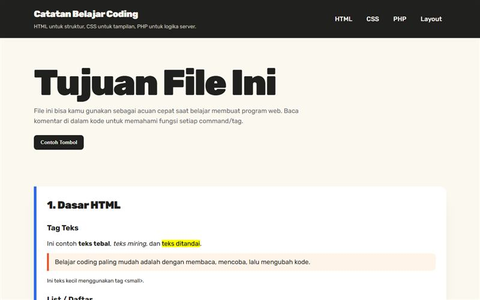

# Buku Saku Web

Catatan HTML, CSS, dan PHP dengan penjelasan di dalam kode.

**Demo:** https://portofolio-jauza-fawaid.netlify.app/MATERI-WEB/



Paket ini berisi:

1. `index.html`  
   Berisi materi HTML, contoh tag, form, tabel, gambar, dan tata letak dasar.

2. `style.css`  
   Berisi materi CSS, selector, warna, margin, padding, flexbox, grid, responsive design, dan komentar fungsi tiap properti penting.

3. `belajar.php`  
   Berisi materi PHP Native, variable, echo, array, looping, if/else, function, class, form POST, dan kerangka CRUD MySQLi.

## Cara Membuka

### HTML dan CSS
Buka langsung file:

```text
index.html
```

di browser.

### PHP Native
PHP tidak bisa berjalan hanya dengan double click file. Gunakan server lokal:

#### Opsi 1: XAMPP
1. Simpan folder ini ke `htdocs`.
2. Jalankan Apache.
3. Buka browser:
   `http://localhost/MATERI-WEB/belajar.php`

#### Opsi 2: PHP Built-in Server
Buka terminal di folder ini, lalu jalankan:

```bash
php -S localhost:8000
```

Kemudian buka:

```text
http://localhost:8000/belajar.php
```

## Urutan Belajar yang Disarankan

1. Baca `index.html`.
2. Ubah teks, heading, tabel, dan form.
3. Baca `style.css`.
4. Ubah warna, padding, margin, flexbox, dan grid.
5. Jalankan `belajar.php`.
6. Coba kirim form.
7. Pelajari bagian CRUD setelah paham dasar PHP.
